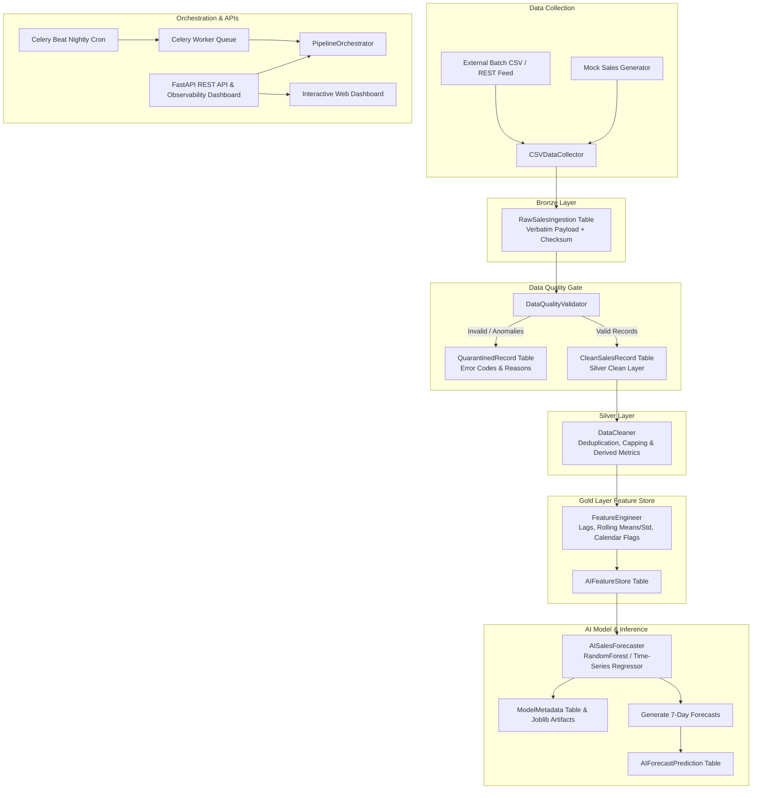

# AI Data Pipeline & Forecasting Backend

A robust, enterprise-grade data backend that **collects, cleans, processes, validates, and stores data for AI models**. Featuring scheduled nightly batch jobs, a dedicated Data Quality Gate with quarantine isolation, an automated Gold Feature Store, and an AI Sales Forecasting model that retrains and produces forward predictions with confidence intervals.

---

## Architecture Overview



---

## Technologies Used

- **Python 3.11+ / 3.13+**
- **SQL & Data Storage**: PostgreSQL (production) with automatic SQLite local fallback
- **Data Manipulation & Quality**: Pandas, NumPy
- **Asynchronous Task Queue & Scheduling**: Celery, Celery Beat, Redis
- **AI Forecasting & Feature Engineering**: Scikit-Learn (RandomForest, Time-Series lags, rolling statistics, evaluation metrics: MAE, RMSE, R², MAPE)
- **Web API & Monitoring**: FastAPI, Uvicorn, Chart.js

---

## Key Features

1. **Multi-Tier Lakehouse Architecture**:
   - **Bronze Layer (`raw_sales_ingestion`)**: Immutable landing table storing raw payloads, source batch ID, and SHA-256 row hashes.
   - **Silver Layer (`clean_sales_records`)**: Deduplicated, standardized, validated, and enriched transactional data.
   - **Data Quality Gate (`quarantined_records`)**: Anomaly quarantine isolation for negative prices, range violations, invalid dates, and missing required fields without crashing pipeline execution.
   - **Gold Layer (`ai_feature_store`)**: Time-series feature store with `lag_1_qty`, `lag_7_qty`, `lag_14_qty`, `rolling_7_mean_qty`, `rolling_7_std_qty`, `rolling_30_mean_qty`, day of week, and promotion flags.
   - **Model Prediction Layer (`ai_forecast_predictions`)**: Forward forecasts for 7–14 days per store/product with 95% confidence bands.
   - **Observability Audit (`pipeline_runs`)**: Tracks execution latencies per stage, row counts, and status history.
   - **Model Registry (`model_metadata`)**: Model version tracking, evaluation metrics (MAE, RMSE, R²), and `.joblib` binary artifacts.

2. **Automated Scheduling**:
   - Celery Beat scheduled cron job (`run-nightly-sales-pipeline`) runs nightly at 00:00 UTC.
   - Hourly health check inspecting data quality trends and quarantine rate spikes.

3. **Resilience & Error Handling**:
   - Celery task retry logic with exponential backoff (`autoretry_for=(Exception,)`, `retry_backoff=True`).
   - Transactional rollback on pipeline errors to prevent corrupted partial state.

4. **Interactive Web Dashboard**:
   - Dark-mode responsive dashboard visualizing:
     - Real-time pipeline KPI metrics
     - Historical sales actuals vs AI forecast predictions with confidence bounds
     - Quarantine breakdown donut chart (reasons for dirty data isolation)
     - Model registry metrics and recent execution runs
     - One-click "Run Pipeline Batch" trigger modal

---

## Directory Structure

```
├── config/
│   ├── __init__.py
│   └── settings.py               # Environment configuration & default paths
├── database/
│   ├── __init__.py
│   ├── connection.py             # SQLAlchemy engine & session factory (Postgres / SQLite)
│   └── models.py                 # Bronze, Silver, Gold, Quarantine, Run, & Model schemas
├── pipeline/
│   ├── __init__.py
│   ├── orchestrator.py           # Master end-to-end pipeline orchestrator
│   ├── collectors/
│   │   ├── csv_collector.py      # Raw CSV file ingestion into Bronze
│   │   └── mock_data_generator.py# Realistic multi-store sales data & anomaly injector
│   ├── validation/
│   │   └── validator.py          # Data Quality Gate & Quarantine router
│   ├── cleaning/
│   │   └── cleaner.py            # Deduplication, string normalization, and derived metrics
│   ├── features/
│   │   └── engineering.py        # Lag and rolling window feature extraction into Gold
│   └── models/
│       └── forecaster.py         # AI Model training, metrics evaluation & forecasting
├── celery_app/
│   ├── __init__.py
│   ├── celery_worker.py          # Celery configuration & Celery Beat schedule
│   └── tasks.py                  # Distributed async Celery tasks
├── api/
│   ├── __init__.py
│   ├── main.py                   # FastAPI application & static dashboard mounting
│   ├── routes/
│   │   ├── pipeline_routes.py    # Pipeline trigger & run telemetry
│   │   ├── quality_routes.py     # Data quality summary & quarantine query
│   │   └── forecast_routes.py    # Forecast predictions & model registry
│   └── static/
│       └── index.html            # Interactive web dashboard
├── tests/
│   ├── test_validation.py        # Validation gate & quarantine tests
│   ├── test_cleaning.py          # Deduplication & cleaning tests
│   ├── test_feature_engineering.py # Lags & rolling calculation tests
│   └── test_api.py               # FastAPI endpoint tests
├── docker-compose.yml            # Multi-container orchestration (Postgres, Redis, API, Worker, Beat)
├── Dockerfile                    # Container definition
├── requirements.txt              # Python dependencies
├── run_pipeline.py               # Standalone CLI execution tool
└── README.md
```

---

## Quickstart Guide

### 1. Installation

Clone the repository and install dependencies:

```bash
python -m pip install -r requirements.txt
```

### 2. Run the Full Pipeline (Standalone CLI)

Execute the end-to-end pipeline immediately (generates synthetic raw sales data, runs validation, cleans, extracts features, trains the AI model, and produces 7-day sales forecasts):

```bash
python run_pipeline.py --mode direct --days 60
```

### 3. Launch the FastAPI Server & Interactive Dashboard

Start the API and Web UI:

```bash
python -m uvicorn api.main:app --reload --port 8000
```

Open your browser to:
- **Interactive Web Dashboard**: [http://localhost:8000](http://localhost:8000)
- **OpenAPI / Swagger Documentation**: [http://localhost:8000/docs](http://localhost:8000/docs)

### 4. Run with Distributed Celery Workers

Start the Celery worker and scheduler (ensure Redis is running):

```bash
# Terminal 1: Celery Worker
celery -A celery_app.celery_worker.celery_app worker --loglevel=info

# Terminal 2: Celery Beat (Nightly Scheduler)
celery -A celery_app.celery_worker.celery_app beat --loglevel=info

# Terminal 3: Dispatch pipeline via Celery
python run_pipeline.py --mode celery
```

### 5. Run Full Stack with Docker Compose

Spin up PostgreSQL, Redis, Celery Worker, Celery Beat, and FastAPI in Docker:

```bash
docker-compose up --build
```

---

## REST API Endpoints Reference

| Method | Endpoint | Description |
|---|---|---|
| `POST` | `/api/pipeline/trigger` | Trigger end-to-end pipeline run (sync direct or async Celery) |
| `GET` | `/api/pipeline/runs` | List execution history and stage audit metrics |
| `GET` | `/api/pipeline/runs/{batch_id}` | Detailed telemetry for a specific pipeline batch run |
| `GET` | `/api/data-quality/summary` | Pass rate, quarantine rate, and error breakdown |
| `GET` | `/api/data-quality/quarantined` | Paginated inspection of quarantined records |
| `GET` | `/api/data-quality/feature-store`| Query Gold Feature Store vectors |
| `GET` | `/api/forecasts/predictions` | Forward sales quantity & revenue forecasts |
| `GET` | `/api/forecasts/models` | AI Model Registry (metrics MAE, RMSE, R², artifact paths) |
| `GET` | `/api/forecasts/series-chart` | Unified time-series for chart visualization |
| `GET` | `/api/health` | Health check for DB, broker, and storage |

---

## Running Automated Tests

Run the full Pytest test suite:

```bash
python -m pytest tests/ -v
```
